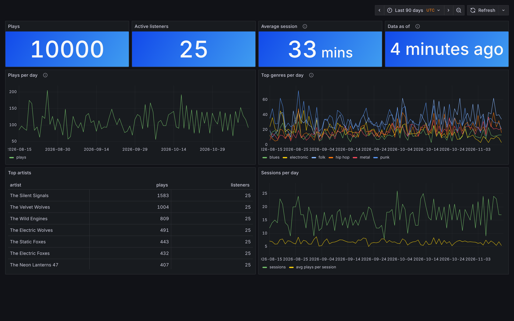

# Songly Insights

API do analizy tego, czego ludzie słuchają: najpopularniejsi artyści i gatunki, sesje
słuchania, trendy i słuchacze o podobnym guście. Dane pochodzą z generatora danych
syntetycznych, z MusicBrainz i opcjonalnie z ListenBrainz.

Stack: FastAPI, SQLAlchemy 2.0, PostgreSQL 16, Alembic, Prefect, Docker, Prometheus, Grafana.



## Uruchomienie lokalnie

Potrzebujesz Pythona 3.12+ i Dockera.

```bash
docker compose up -d db
python -m venv .venv && source .venv/bin/activate
pip install -e ".[dev]"
cp .env.example .env
alembic upgrade head
python -m app.cli seed --reset
python -m pipeline run
uvicorn app.main:app --reload
```

Dokumentacja API jest pod <http://localhost:8000/docs>. Kilka przykładów:

```bash
curl "localhost:8000/api/v1/stats/top-artists?from=2025-12-01&to=2026-01-01&limit=5"
curl "localhost:8000/api/v1/stats/trending-artists?from=2025-12-02&to=2026-01-01"
curl "localhost:8000/api/v1/listeners/1/similar?limit=3"
```

Statystyki są liczone z tabel, które buduje pipeline, więc po dodaniu nowych odsłuchów trzeba
go uruchomić ponownie (`python -m pipeline run`).

## Co jest w środku

- **API** – katalog artystów, utworów i gatunków, import odsłuchów (ponowny import tych samych
  danych niczego nie dubluje) i statystyki w oknach czasowych.
- **Pipeline** – Prefect przenosi dane przez trzy warstwy w PostgreSQL: surowe odpowiedzi
  z zewnętrznych API (`raw`), oczyszczone widoki (`staging`) i tabele analityczne (`marts`).
  Po każdym kroku sprawdza jakość danych.
- **Analityka** – sesje słuchania (przerwa dłuższa niż 30 minut kończy sesję), trendy
  (porównanie z poprzednim okresem) i podobieństwo słuchaczy (podobieństwo kosinusowe).
- **Wdrożenie** – cały system w Docker Compose, HTTPS przez Caddy, metryki w Prometheusie,
  dashboardy w Grafanie, alerty na Discorda i codzienne kopie zapasowe bazy.

## Import prawdziwych danych

Ustaw w `.env` zmienną `MUSICBRAINZ_CONTACT` (e-mail albo adres projektu – MusicBrainz o to
prosi), a potem:

```bash
python -m pipeline run --musicbrainz-tag jazz
python -m pipeline run --listenbrainz-user twoja_nazwa
```

## Wdrożenie

```bash
cp .env.example .env
docker compose --profile full up -d --build
docker compose --profile full run --rm pipeline python -m app.cli seed --reset --end-date today
docker compose --profile full run --rm pipeline python -m pipeline run
```

Na serwerze zmień hasła w `.env` i ustaw `API_DOMAIN` oraz `GRAFANA_DOMAIN` – Caddy sam pobierze
certyfikaty. Z zewnątrz dostępne są tylko API i Grafana. Prometheus (9090), Alertmanager (9093)
i Prefect (4200) słuchają na `127.0.0.1`, więc do nich wchodzi się przez tunel SSH.

Żeby dostawać alerty na Discorda, wklej adres webhooka kanału do `DISCORD_WEBHOOK_URL`.

Kopie zapasowe lądują w `./backups`. Odtworzenie bazy:

```bash
docker compose --profile full stop api pipeline
docker compose --profile full run --rm backup restore /backups/NAZWA_PLIKU.dump
docker compose --profile full start api pipeline
```

## Testy

Testy potrzebują działającego PostgreSQL (`docker compose up -d db`):

```bash
ruff check . && ruff format --check . && pytest
```
