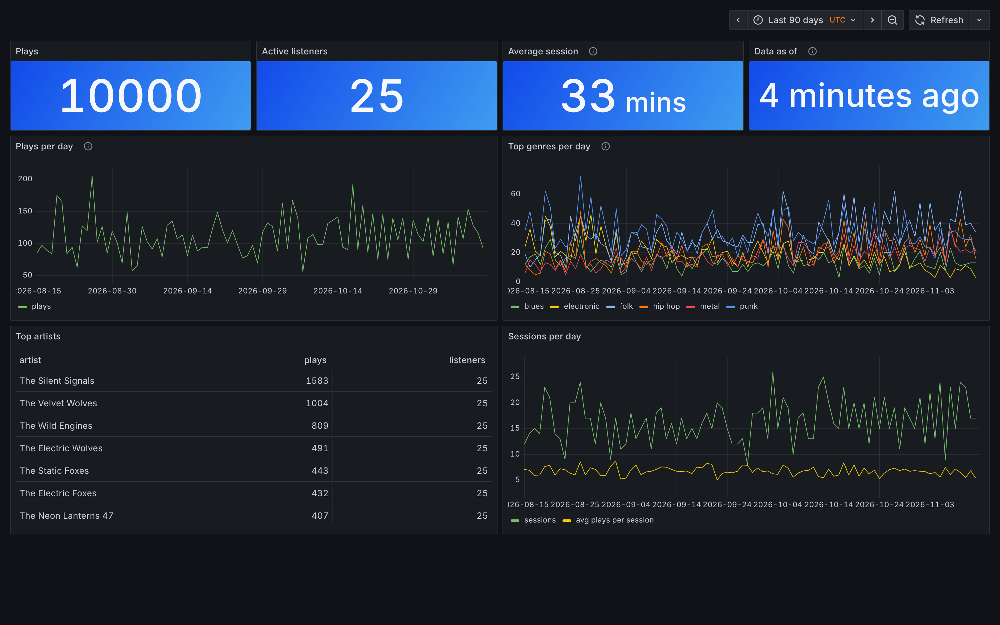
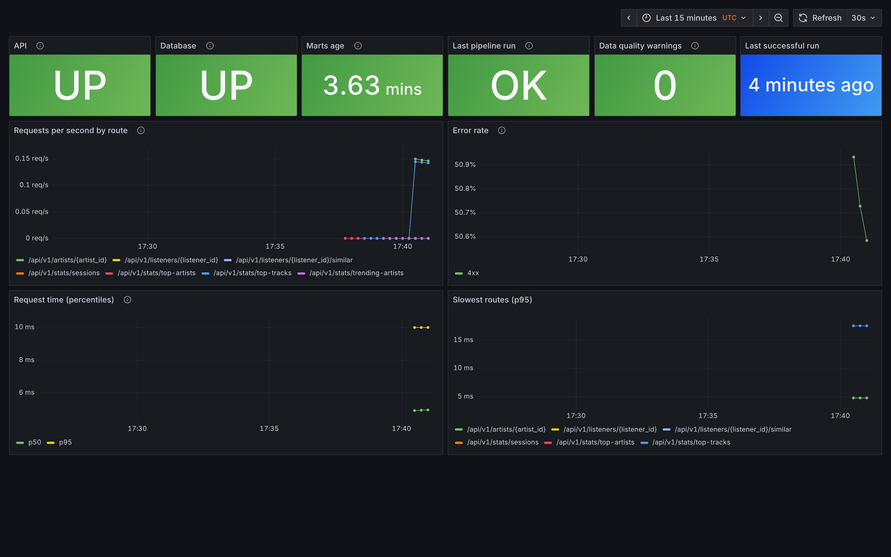

# Songly Insights

API do analizy odsłuchów muzyki: kto czego słucha, kiedy i jakich gatunków, oraz pipeline
danych, który buduje z tych odsłuchów tabele analityczne, wzbogaca katalog danymi z MusicBrainz
i importuje prawdziwe odsłuchy z ListenBrainz.
Zbudowane w **FastAPI**, **SQLAlchemy 2.0**, **Alembic**, **PostgreSQL 16** i **Prefect 3**;
wdrażane w **Dockerze**, monitorowane przez **Prometheus** i **Grafanę**.

Projekt portfolio rozwijany etapami (zobacz [Roadmapę](#roadmapa)).

## Szybki start

Wymagania: Python 3.12+, Docker (albo lokalny PostgreSQL 16).

```bash
docker compose up -d db          # PostgreSQL + baza testowa insights_test
python -m venv .venv && source .venv/bin/activate
pip install -e ".[dev]"
cp .env.example .env
alembic upgrade head             # schemat bazy z migracji
python -m app.cli seed --reset   # dane syntetyczne: 25 słuchaczy, 10 000 odsłuchów
python -m pipeline run           # buduje marts, z których API liczy statystyki
uvicorn app.main:app --reload
```

Dokumentacja interaktywna: <http://localhost:8000/docs>.

Przykłady:

```bash
curl "localhost:8000/api/v1/stats/top-artists?from=2025-12-01&to=2026-01-01&limit=5"
curl "localhost:8000/api/v1/stats/daily?from=2025-12-25&to=2026-01-01&listener_id=1"
curl "localhost:8000/api/v1/listeners/1/summary"
```

Dane syntetyczne obejmują 90 dni kończących się 2026-01-01 (UTC), więc wyniki są zawsze takie same.

## Endpointy

Wszystkie poza `/health` mają prefiks `/api/v1`.

| Metoda | Ścieżka | Opis |
|---|---|---|
| GET | `/health` | Stan API i połączenia z bazą (503, gdy baza nie odpowiada) |
| GET, POST | `/genres` | Lista gatunków / nowy gatunek |
| GET, POST | `/artists` | Lista artystów (`q` – wyszukiwanie po nazwie, paginacja) / nowy artysta |
| GET | `/artists/{id}` | Artysta z gatunkami |
| GET, POST | `/tracks` | Lista utworów (filtr `artist_id`) / nowy utwór |
| GET | `/tracks/{id}` | Utwór |
| GET, POST | `/listeners` | Lista słuchaczy / nowy słuchacz |
| GET | `/listeners/{id}` | Słuchacz |
| GET | `/listeners/{id}/summary` | Podsumowanie słuchacza w oknie czasowym |
| POST | `/listening-events/bulk` | Idempotentny import do 10 000 odsłuchów |
| GET | `/listening-events` | Lista odsłuchów (okno czasowe, `listener_id`, paginacja) |
| GET | `/stats/top-tracks` | Najczęściej słuchane utwory |
| GET | `/stats/top-artists` | Najczęściej słuchani artyści |
| GET | `/stats/top-genres` | Najczęściej słuchane gatunki |
| GET | `/stats/daily` | Liczba odsłuchów na dzień (UTC) |
| GET | `/stats/sessions` | Sesje słuchania: liczba, średnia i mediana długości, najdłuższa |
| GET | `/stats/trending-artists` | Artyści z największym wzrostem (`direction=falling`: spadkiem) względem poprzedniego okna |
| GET | `/stats/trending-genres` | To samo dla gatunków |
| GET | `/listeners/{id}/sessions` | Sesje słuchacza, od najnowszych (paginacja) |
| GET | `/listeners/{id}/similar` | Słuchacze o najbardziej podobnym guście, ze wspólnymi artystami |

Statystyki przyjmują `from`, `to` (okno czasowe), `listener_id` i `limit` (1–100).
Listy przyjmują `limit` (1–200) i `offset`.

**Statystyki czytają marts** zbudowane przez pipeline
([ADR 0007](docs/adr/0007-statystyki-api-z-martow.md)):

- `from` i `to` muszą być pełnymi dniami UTC (`2026-01-01` lub `2026-01-01T00:00:00Z`),
- odpowiedź zawiera `data_as_of`, czyli czas ostatniego uruchomienia pipeline'u; nowe
  odsłuchy z `/listening-events/bulk` są widoczne w statystykach po kolejnym uruchomieniu,
- przed pierwszym uruchomieniem pipeline'u statystyki zwracają `503 marts_not_ready`.

### Sesje, trendy i podobieństwo (etap 3)

- **Sesja** to ciąg odsłuchów, w którym kolejny utwór zaczyna się najwyżej 30 minut po
  poprzednim. Sesja należy do dnia UTC, w którym się zaczęła
  ([ADR 0010](docs/adr/0010-sesje-sluchania.md)).
- **Trend** porównuje okno z poprzednim oknem tej samej długości, np. ostatni tydzień
  z tygodniem wcześniej; ranking według bezwzględnej zmiany liczby odsłuchów
  ([ADR 0011](docs/adr/0011-trendy.md)).
- **Podobieństwo słuchaczy** to podobieństwo kosinusowe wektorów „artysta → liczba odsłuchów”
  (1,0 = te same proporcje). Wynik zawiera wspólnych artystów, którzy wyjaśniają podobieństwo
  ([ADR 0012](docs/adr/0012-podobienstwo-sluchaczy.md)).

```bash
curl "localhost:8000/api/v1/stats/trending-artists?from=2025-12-02&to=2026-01-01&limit=5"
curl "localhost:8000/api/v1/stats/sessions?from=2025-12-01&to=2026-01-01"
curl "localhost:8000/api/v1/listeners/1/sessions?limit=5"
curl "localhost:8000/api/v1/listeners/1/similar?limit=3"
```

### Reguły domenowe

- Okno czasowe jest półotwarte: `from` włącznie, `to` wyłącznie. Daty bez strefy czasowej
  to UTC, a dni są liczone w UTC ([ADR 0003](docs/adr/0003-okna-czasowe-utc-i-gatunki.md)).
- Odsłuch jest unikalny po `(listener_id, track_id, listened_at)`, więc ponowny import tych
  samych danych niczego nie dubluje
  ([ADR 0002](docs/adr/0002-unikalnosc-zdarzen-i-idempotentny-import.md)).
- Odsłuch liczy się do każdego gatunku artysty, dlatego suma po gatunkach może być większa
  niż liczba odsłuchów.

### Format błędów

Każdy błąd ma ten sam kształt:

```json
{"error": {"code": "invalid_time_window", "message": "`from` must be earlier than `to`", "details": {}}}
```

Kody: `validation_error` (422), `invalid_time_window` (422), `unknown_reference` (422),
`not_found` (404), `conflict` (409), `method_not_allowed` (405), `database_unavailable` (503),
`marts_not_ready` (503),
`internal_error` (500).

## Pipeline danych (etap 2)

```
API (public) ──────────────┐
MusicBrainz ──► raw (JSON) ├─► staging (widoki) ─► marts (tabele) ─► statystyki API
ListenBrainz ─► raw (JSON) ┘          │
                                      └─► katalog API (artyści, gatunki, utwory, odsłuchy)

Testy jakości danych: przed staging, po staging i po marts.
```

```bash
python -m pipeline run                                            # tylko dane z API
python -m pipeline run --musicbrainz-tag jazz --musicbrainz-tag rock --artists-per-tag 50
python -m pipeline run --musicbrainz-tag jazz --recordings-per-artist 0   # bez nagrań
python -m pipeline run --listenbrainz-user moja_nazwa --listens-per-user 500   # odsłuchy
python -m pipeline serve --cron "15 3 * * *"                     # codziennie o 3:15 UTC
```

Przed importem ustaw `MUSICBRAINZ_CONTACT` w `.env` (e-mail lub adres projektu): MusicBrainz
i ListenBrainz proszą o kontakt w nagłówku User-Agent. Odsłuchy z ListenBrainz są publiczne,
ale to dane osobowe: importuj swoje konto albo konta osób, które się zgodziły. Historia uruchomień i logi w UI Prefecta:
`prefect server start`.

| Warstwa | Co zawiera |
|---|---|
| `raw` | Odpowiedzi MusicBrainz (artyści, nagrania) i ListenBrainz (odsłuchy) w całości (`jsonb`), tylko dopisywane |
| `staging` | Widoki: oczyszczone dane z API i rozpakowany JSON (najnowsza wersja artysty i nagrania, odsłuchy bez duplikatów) |
| `marts.listener_track_daily` | Dzień (UTC) × słuchacz × utwór: odsłuchy, czas, pierwszy/ostatni odsłuch. Źródło statystyk API |
| `marts.daily_listener_activity` | Dzień (UTC) × słuchacz: odsłuchy, unikalne utwory i artyści, czas słuchania |
| `marts.daily_genre_plays` | Dzień (UTC) × gatunek: odsłuchy i unikalni słuchacze |
| `marts.listening_sessions` | Sesja słuchania: słuchacz, początek, koniec, odsłuchy, unikalne utwory i artyści |
| `marts.artist_popularity` | Artysta: odsłuchy, słuchacze, pierwszy/ostatni odsłuch, kraj i typ z MusicBrainz |

Testy jakości danych (`pipeline/quality.py`) sprawdzają źródła, staging i marts, np. czy
w marcie jest dokładnie tyle odsłuchów, ile w danych źródłowych. Błąd zatrzymuje pipeline.
Szczegóły: [ADR 0005](docs/adr/0005-warstwy-danych-i-prefect.md),
[ADR 0006](docs/adr/0006-import-musicbrainz.md).

## Wdrożenie (etap 4)

Cały system w Dockerze: API, PostgreSQL, pipeline z harmonogramem, Prefect, Prometheus
i Grafana ([ADR 0013](docs/adr/0013-wdrozenie-docker.md)).

```bash
cp .env.example .env      # na serwerze: zmień wszystkie hasła!
docker compose --profile full up -d --build
docker compose --profile full run --rm pipeline python -m app.cli seed --reset --end-date today
docker compose --profile full run --rm pipeline python -m pipeline run
```

| Usługa | Adres | Co robi |
|---|---|---|
| API | <http://localhost:8000/docs> | Endpointy; `/metrics` dla Prometheusa |
| Grafana | <http://localhost:3000> (admin / `GRAFANA_ADMIN_PASSWORD`) | Dashboardy w folderze „Songly Insights” |
| Prometheus | <http://localhost:9090/alerts> | Metryki i alerty |
| Prefect | <http://localhost:4200> | Przebiegi pipeline'u; codziennie o `PIPELINE_CRON` (UTC) |
| Alertmanager | <http://localhost:9093> | Wysyłka alertów na Discord, wyciszenia |

Migracje wykonuje jednorazowa usługa `migrate` przed startem API. CI publikuje gotowy obraz
w GitHub Container Registry; na serwerze wystarczy ustawić `SONGLY_IMAGE` w `.env`
i pominąć `--build`.

## Monitoring i dashboardy

[ADR 0014](docs/adr/0014-monitoring-i-dashboardy.md): Prometheus zbiera metryki API
(ruch, błędy, czasy odpowiedzi) i stan danych (wiek martów, wynik ostatniego przebiegu
pipeline'u z `ops.pipeline_runs`). Reguły alertów mają testy (`promtool test rules`).

### Alerty na Discordzie

Alertmanager wysyła alerty na kanał Discorda, grupuje je, przypomina o trwających problemach
co 4 h i informuje o naprawie ([ADR 0015](docs/adr/0015-alertmanager-discord.md)).

1. W Discordzie: ustawienia kanału → Integracje → Webhooki → Nowy webhook → Kopiuj URL.
2. W `.env` na serwerze: `DISCORD_WEBHOOK_URL=<skopiowany adres>` (to sekret, nie commituj go).
3. `docker compose --profile full up -d`, a potem test wysyłki:

```bash
docker compose exec alertmanager amtool alert add SonglyTestAlert severity="info" --annotation='summary="Test notification from Songly Insights"' --alertmanager.url=http://localhost:9093
```

Po ok. 30 s na kanale pojawi się wiadomość `[FIRING] SonglyTestAlert`.




## Struktura projektu

```
app/
  main.py          tworzenie aplikacji, podpięcie routerów i obsługi błędów
  config.py        ustawienia z .env (pydantic-settings)
  db.py            silnik, sesje, Base z konwencją nazw ograniczeń
  models.py        modele SQLAlchemy
  marts.py         tabele martów czytane przez statystyki (tworzy je pipeline, nie Alembic)
  errors.py        wspólny format błędów
  routers/         warstwa HTTP (cienka): parametry -> serwis -> odpowiedź
  services/        logika i zapytania: katalog, import odsłuchów, statystyki, sesje, trendy,
                   podobieństwo słuchaczy, stan danych dla monitoringu
  metrics.py       metryki Prometheusa i middleware mierzące zapytania
  schemas/         modele Pydantic (kontrakt API)
  seed/            deterministyczny generator danych i loader
  cli.py           python -m app.cli seed
pipeline/
  sql/             definicje warstw staging i marts (czysty SQL)
  layers.py        budowanie warstw w jednej transakcji
  quality.py       testy jakości danych
  http.py          wspólny limit zapytań i User-Agent
  musicbrainz.py   klient MusicBrainz, artyści i nagrania do raw, publikacja do katalogu
  listenbrainz.py  klient ListenBrainz, przyrostowy import odsłuchów, publikacja zdarzeń
  flows.py         flow Prefect łączący kroki
deploy/            konfiguracja Prometheusa (alerty + testy), Alertmanagera (Discord)
                   i Grafany (dashboardy jako JSON)
migrations/        migracje Alembic
tests/             testy na prawdziwym PostgreSQL
docs/adr/          zapisy decyzji architektonicznych
```

## Testy i jakość

```bash
ruff check . && ruff format --check . && pytest
```

Testy łączą się z bazą `insights_test` (`TEST_DATABASE_URL`), czyszczą ją i budują schemat
z prawdziwych migracji. Testy pipeline'u nie łączą się z MusicBrainz (udawane odpowiedzi HTTP).
Jeden z testów porównuje modele z migracjami i nie przejdzie, jeśli
zmienisz model bez `alembic revision --autogenerate -m "..."`. Ten sam zestaw uruchamia
GitHub Actions przy każdym pushu.

## Decyzje architektoniczne

- [ADR 0001: Stos technologiczny API](docs/adr/0001-stos-technologiczny.md)
- [ADR 0002: Unikalność zdarzeń i idempotentny import](docs/adr/0002-unikalnosc-zdarzen-i-idempotentny-import.md)
- [ADR 0003: Okna czasowe, dni w UTC i liczenie gatunków](docs/adr/0003-okna-czasowe-utc-i-gatunki.md)
- [ADR 0004: Źródła danych (bez Spotify Web API)](docs/adr/0004-zrodla-danych.md)
- [ADR 0005: Warstwy raw → staging → marts i Prefect](docs/adr/0005-warstwy-danych-i-prefect.md)
- [ADR 0006: Import artystów z MusicBrainz](docs/adr/0006-import-musicbrainz.md)
- [ADR 0007: Statystyki API czytane z martów](docs/adr/0007-statystyki-api-z-martow.md)
- [ADR 0008: Nagrania z MusicBrainz jako utwory](docs/adr/0008-nagrania-z-musicbrainz.md)
- [ADR 0009: Odsłuchy z ListenBrainz](docs/adr/0009-odsluchy-z-listenbrainz.md)
- [ADR 0010: Sesje słuchania](docs/adr/0010-sesje-sluchania.md)
- [ADR 0011: Trendy](docs/adr/0011-trendy.md)
- [ADR 0012: Podobieństwo słuchaczy](docs/adr/0012-podobienstwo-sluchaczy.md)
- [ADR 0013: Wdrożenie w Dockerze](docs/adr/0013-wdrozenie-docker.md)
- [ADR 0014: Monitoring i dashboardy](docs/adr/0014-monitoring-i-dashboardy.md)
- [ADR 0015: Wysyłka alertów na Discord](docs/adr/0015-alertmanager-discord.md)

## Roadmapa

1. **Etap 1: API analityczne** (gotowe): katalog, idempotentny import odsłuchów, statystyki
   w oknach czasowych, dane syntetyczne, testy na PostgreSQL, CI.
2. **Etap 2: pipeline danych** (gotowe): warstwy raw → staging → marts w PostgreSQL,
   orkiestracja w Prefect, testy jakości danych, import artystów, tagów i nagrań z MusicBrainz,
   przyrostowy import odsłuchów z ListenBrainz.
   Statystyki API czytają marts.
3. **Etap 3: analityka zachowań** (gotowe): sesje słuchania, trendy, podobieństwo słuchaczy.
4. **Etap 4: wdrożenie i monitoring** (w toku): obraz Dockera i pełny stos w compose, obraz
   publikowany przez CI, metryki i alerty w Prometheusie, wysyłka alertów na Discord,
   dashboardy w Grafanie (gotowe). Dalej: HTTPS, kopie zapasowe bazy, logi w formacie JSON.
